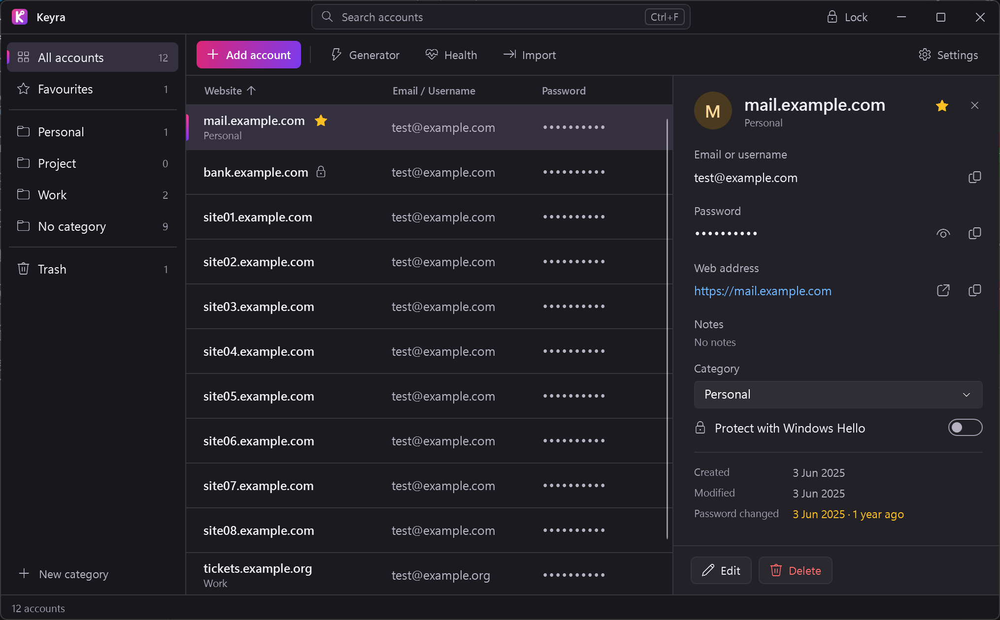
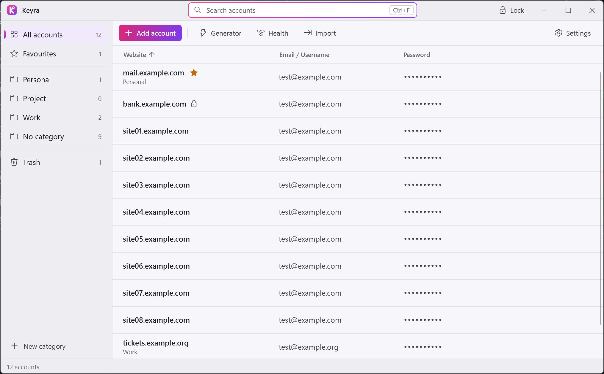
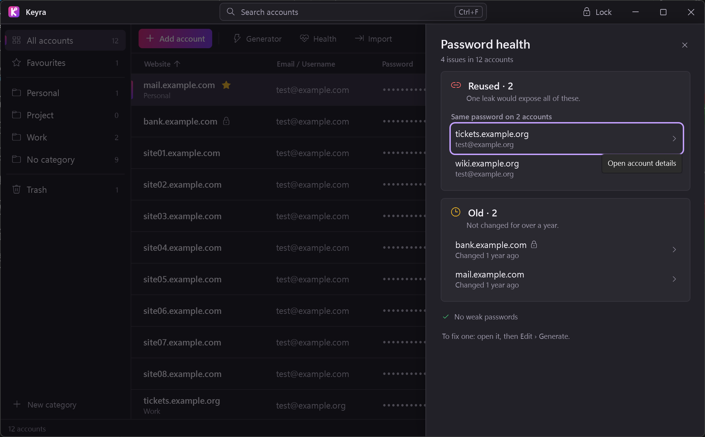
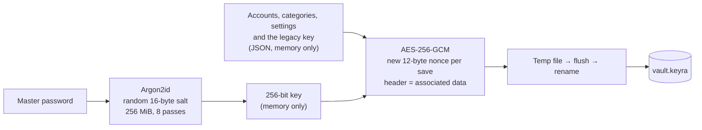

  

<h1 align="center">Keyra</h1>

  A small, local, offline password vault for Windows. 
  One encrypted file. No account, no cloud, no telemetry.

  

## Features

- **Encrypted at rest:** Argon2id (256 MiB, 8 passes) derives the key from your master password; AES-256-GCM encrypts the whole vault into one file.
- **Offline by design:** Keyra has no network code: no telemetry, no update check. It never sends anything anywhere.
- **Accounts:** website, email or username, password, and optional web address and notes. Under "More details": recovery email, recovery phone, PIN and security questions. Search covers website, email, web address, category and recovery email.
- **Categories and favourites:** a sidebar with All, Favourites, your categories (Personal, Work and Project to start) and No category, each with a count. Star an account to keep it on top.
- **Details panel:** copy the email, password, web address, notes and recovery fields, open the web address in your browser, see when an account was created and when its password last changed. Passwords older than a year are flagged.
- **Trash and multi-select:** deleted accounts stay in Trash for 30 days (restore, delete forever or empty the Trash). Select several accounts with Ctrl-click, Shift-click or Ctrl+A to move them to a category, protect them with Windows Hello, or move them to Trash in one step.
- **Password history:** the last 5 passwords of each account, with show, copy and restore.
- **Health report:** reused, weak and old passwords, problems first, with a tip on how to fix them. It never shows a password.
- **Hidden by default:** passwords, notes, the recovery phone, PIN, security answers and old passwords are masked. A revealed value hides again after 20 seconds, when you select another account, when a dialog opens, when the window loses focus, or when the vault locks.
- **Screen-capture blocking:** Keyra's windows are left out of screenshots, recordings and screen sharing (on by default; always on while locked). Optionally blur the list rows you are not pointing at.
- **Windows Hello for chosen accounts:** protected accounts ask for Windows Hello (or the master password) before a secret is shown or copied, or the account is changed. This is an extra gate inside the unlocked app, not extra encryption.
- **Legacy access:** give heirs a way in without your master password. Keyra makes three shares; any two of them open a read-only snapshot of the accounts you choose (none by default).
- **Safe clipboard:** copied values are kept out of Windows clipboard history and cloud clipboard and are cleared after 30 seconds (adjustable).
- **Auto-lock:** after inactivity (5 minutes by default), on minimize, when Windows locks, on sleep and on exit. Optionally hide Keyra next to the clock instead of the taskbar (Minimize to tray); it locks when it hides.
- **Calm lock screen:** says what Keyra is (Encrypted · Offline · No tracking) and its version, warns when Caps Lock is on, and helps without alarm after a wrong password.
- **Password generator:** 8–128 characters, character sets of your choice, look-alike characters can be excluded, strength shown in bits.
- **Import:** CSV exports from Chrome, Edge, Firefox, Bitwarden, KeePass, KeePassXC, LastPass, Proton Pass or a simple sheet (UTF-8), including folder or category and favourite columns. Keyra shows how to export from the app you pick, previews what will be added (never a password), and deletes the plaintext CSV after the import. It never reads a browser's password store directly.
- **Short tour:** after the first unlock, six tips point at the main parts of the app. Settings → Take the tour again.
- **Backup and restore:** of the encrypted file only. There is no plaintext export. Settings shows when you last backed up, and Keyra reminds you when there has been no backup for 30 days (and something changed since the last one).
- **Light and dark theme:** follows Windows, or choose one.

  
  &nbsp;
  

> [!IMPORTANT]
> Keyra cannot recover a forgotten master password, and nobody else can either. Keep backups of the encrypted vault somewhere safe. Legacy access is not a recovery tool: it opens only a read-only snapshot of the accounts you chose.

> [!NOTE]
> This repository holds the **installer, the user documentation and the security notes**. The source code is not published (yet); it may be later. Keyra is free for personal and non-profit use under the [PolyForm Noncommercial License 1.0.0](LICENSE); business use needs a separate paid license (see License).

## How it works

Saving (unlocking runs the same steps backwards: salt and parameters from the header, then Argon2id, then the key, then AES-GCM decryption):

- The correct password is proven only by a successful decryption. There is no stored hash or verifier.
- Any changed byte in the file, including the header, makes decryption fail. Keyra then shows no data, does not overwrite the file and does not create a new vault.
- Saves are atomic: a crash during a save leaves the previous vault intact.
- Right before a save Keyra checks that the file is still the one it opened. If another PC or OneDrive changed it before the save, Keyra writes nothing and locks, so the other change is kept (only a change in the same instant as the save can slip through; see the [threat model](docs/threat-model.md), T4).
- Windows Hello never unlocks the vault and never holds a key. It only gates protected accounts inside an unlocked vault.
- Legacy access uses a separate random legacy key, kept only inside the encrypted vault. It is wrapped once for each pair of shares (HKDF-SHA256 pair key, AES-256-GCM) and encrypts the snapshot. A single share reveals nothing. See [legacy access](docs/legacy-access.md).

More: [security](docs/security.md), [threat model](docs/threat-model.md), [file format](docs/vault-format.md), [legacy access](docs/legacy-access.md).

## Install

Keyra needs Windows 10 version 2004 (build 19041) or later, x64. It installs as an MSIX package signed with a self-signed certificate (subject `CN=Keyra Dev`).

1. From [Releases](https://github.com/biswajitpanday/keyra-releases/releases), download `Keyra_<version>_x64.msix` and `KeyraDev.cer`.
2. Check the download. In PowerShell, in the download folder:
   `Get-FileHash .\Keyra_<version>_x64.msix -Algorithm SHA256` must match the SHA-256 on the release page. This shows the file is complete; it cannot prove who made it.
3. Check the signer:
   `(Get-AuthenticodeSignature .\Keyra_<version>_x64.msix).SignerCertificate.Thumbprint` and `(Get-PfxCertificate .\KeyraDev.cer).Thumbprint` must both be
   `AA4E8EA05917E2598282E8120D44F17A1178D97D`. If either differs, stop and do not install. This catches a swapped file or a different certificate. It cannot help if this GitHub account itself is taken over.
4. Once, in an **admin** PowerShell, trust the certificate:
   `Import-Certificate -FilePath '.\KeyraDev.cer' -CertStoreLocation Cert:\LocalMachine\TrustedPeople`
   This trusts every package signed with this certificate on this PC, so only do it if you trust the publisher. Use `TrustedPeople`, never `Root`.
5. Install: `Add-AppxPackage -Path '.\Keyra_<version>_x64.msix'` (or double-click the file), then start **Keyra** from the Start menu.

The first start asks you to create a master password. Keyra cannot recover it. Make a backup right after (Settings → Back up vault).

## Update

Keyra never checks for updates by itself. To update:

1. Make a backup (Settings → Back up vault).
2. Download the new version and check its SHA-256 and signer as above.
3. Close Keyra and run `Add-AppxPackage` with the new MSIX. It upgrades in place; your vault in `Documents\Keyra` is not touched.

To get notified, use **Watch → Custom → Releases** on this repository.

## Uninstall and remove data

1. Settings → Apps → Keyra → Uninstall. This removes the app and, usually, its theme choice and event log. Your vault in the Documents folder is **not** removed.
2. To remove the certificate trust, in an **admin** PowerShell:
   `Get-ChildItem Cert:\LocalMachine\TrustedPeople | Where-Object Thumbprint -eq 'AA4E8EA05917E2598282E8120D44F17A1178D97D' | Remove-Item`
   (or `certlm.msc` → Trusted People → Certificates → `Keyra Dev` → Delete).
3. To remove your data, delete `Documents\Keyra` (the vault, `.bak` copies from restores) and your own backups and legacy snapshot files. This cannot be undone. If Documents is in OneDrive, also check the OneDrive recycle bin and version history.
4. If `%LOCALAPPDATA%\Keyra` exists, delete it too.

## Where things are

| What | Where |
|---|---|
| Vault (encrypted) | `Keyra\vault.keyra` in your Documents folder: usually `%USERPROFILE%\Documents`, or `%USERPROFILE%\OneDrive\Documents` when OneDrive backs up Documents. If Documents is synced, the encrypted file syncs too. |
| Previous vault after a restore | same folder, `vault.keyra.pre-restore-<time>.bak` |
| Legacy snapshot (encrypted, only if you set up legacy access) | the file you choose |
| Theme choice and event log (no secrets) | `%LOCALAPPDATA%\Keyra\`, or the MSIX private copy of it |

## Keyboard

| Keys | Action |
|---|---|
| Ctrl+F | Search |
| Ctrl+N | Add account |
| Ctrl+G | Password generator |
| Ctrl+L | Lock |
| Enter / click | Open the details panel of the selected account |
| Double-click | Edit the account |
| Space | Show or hide the selected password |
| Ctrl+C / Ctrl+B | Copy password / copy email of the selected account |
| Ctrl-click / Shift-click / Ctrl+A | Select several accounts (in the current view) |
| Del | Move the selected account(s) to Trash (asks first); in Trash, delete forever |
| F2 / Del in the sidebar | Rename / delete the selected category |
| Esc | Close the dialog, panel or tour (skip); in the search box, clear the search; with several accounts selected, clear the selection |
| Tab | Moves through the screen in reading order; dialogs keep the focus inside |

On a protected account, Space, Ctrl+C, Del and double-click ask for Windows Hello first.

## Limitations

- Windows only, single user, one vault. No sync service and no browser autofill.
- While unlocked, account data lives in normal .NET strings, which cannot be reliably wiped from memory.
- The MSIX is signed with a self-signed certificate, so you trust it once by hand (see Install).
- Windows Hello protection guards the app, not the file: anyone with the master password can open every account.
- Screen-capture blocking does not stop a camera or software that gets around Windows display affinity.
- A legacy snapshot is a copy made by hand. It does not update itself; Keyra reminds you when it is out of date.
- Minimize to tray hides Keyra only after locking it; the tray icon exists only while Keyra is hidden.
- Updates are installed by hand; Keyra does not tell you when a new version exists.
- If two PCs change the vault at the same time (for example through OneDrive), Keyra does not merge: it keeps the other change and locks; your unsaved change is not made.

## Documentation

- [Security](docs/security.md): what is protected and how
- [Privacy](docs/privacy.md): what Keyra stores, and where
- [FAQ and troubleshooting](docs/faq.md)
- [Settings](docs/settings.md): every setting and its default
- [Threat model](docs/threat-model.md)
- [Vault format](docs/vault-format.md)
- [Backup and recovery](docs/backup-and-recovery.md)
- [Legacy access](docs/legacy-access.md)
- [Release notes](docs/release-notes.md)

## Questions and bugs

First look at the [FAQ](docs/faq.md). Bugs and ideas: open an [issue](https://github.com/biswajitpanday/keyra-releases/issues/new/choose) (bug report or feature request). Never post real passwords, a real vault file, shares or screenshots of real data.

## Security

Please report vulnerabilities privately. See [SECURITY.md](SECURITY.md).

## License

[PolyForm Noncommercial 1.0.0](LICENSE) © 2026 Biswajit Panday. Free for personal use and for non-profit organizations. Use in or for a business needs a separate paid license: email biswajitmailid@gmail.com. The app has no license key, check or expiry.

Third-party licenses: [THIRD-PARTY-NOTICES.txt](THIRD-PARTY-NOTICES.txt) (also inside the package).
